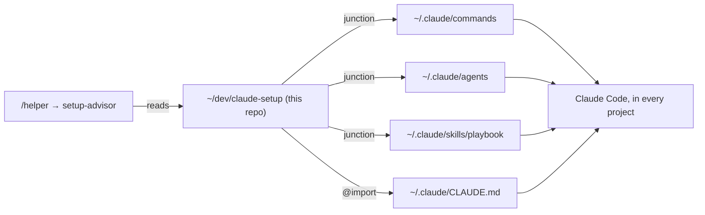

# Plan

## How the setup is wired

## Tasks
| # | Task | Test that proves it | Status |
|---|---|---|---|
| 1 | Move the kit into this repo and link it | A file added here appears in `~/.claude`; `/where` still works in a new session | done |
| 2 | `/helper` + `setup-advisor` agent | `/helper` in flAIre names the right phase and next command | done |
| 3 | Publish publicly; QR on the talk's closing slide | Repo opens logged out; QR scans to it | done |
| 4 | Use it on the next real project, then a retro | Retro notes in IDEAS.md | todo |

>> YOU ARE HERE: task 4, use the kit on flAIre until it ships, then a retro into IDEAS.md

## Decision log
| Date | Decision | Why |
|---|---|---|
| 27 Oct 2026 | Junctions, not a copy script | One copy of each file; nothing to remember to re-run |
| 27 Oct 2026 | Only my own files live here; other people's skills stay installed in `~/.claude/skills` and are listed in TOOLS.md | Their repos are the source; copying them would go stale |
| 27 Oct 2026 | Public repo | Shareable from the talk; contains no secrets |
| 27 Oct 2026 | Repo test = a Bash check that every kit file is reachable through `~/.claude` and the import is in place (in CLAUDE.md) | No code to unit-test; a broken link is the real failure mode |
