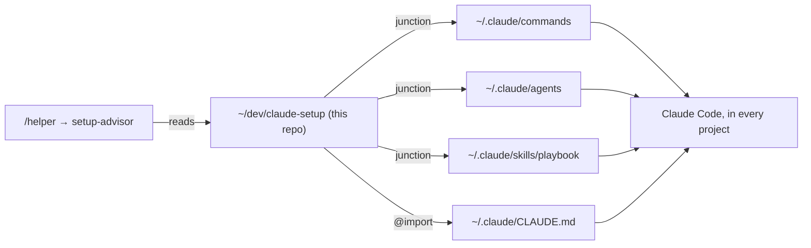

# claude-setup

The one place my Claude Code setup lives: a 9-phase playbook, the commands and agents that run it, and a helper that tells me which tool to use next. Built after I ended up with 8 plugins, 66 skills and no idea when to use what.

Start with [GUIDE.md](GUIDE.md): what every file, command, skill and agent is for, and the daily routine.

## What's here

| Path | What it is | Where Claude Code sees it |
|---|---|---|
| `global/CLAUDE.md` | My rules for every project | Imported by `~/.claude/CLAUDE.md` |
| `skills/playbook/` | The 9 phases, their gate files, and templates | `~/.claude/skills/playbook` (link) |
| `commands/` | `/kickoff` `/ideas` `/deepen` `/panel` `/where` `/tour` `/helper` `/checkpoint` `/ui-pass` | `~/.claude/commands` (link) |
| `agents/` | `judge` `skeptic` `domain-expert` `ui-critic` `setup-advisor` | `~/.claude/agents` (link) |
| `TOOLS.md` | Plugins, other people's skills, MCP servers and hooks, with install commands | read by `setup-advisor` |
| `scripts/link.ps1` | Links `~/.claude` to this repo (backs up real folders first) | run once per machine |
| `IDEAS.md` | Parking lot for new tool ideas | read by `setup-advisor` |
| `HANDOFF.md` | Where the last session here stopped | printed at session start |

## How it's wired

## Install on a machine

1. Clone to `~/dev/claude-setup`.
2. In PowerShell: `powershell -ExecutionPolicy Bypass -File scripts/link.ps1`.
3. Put `@~/dev/claude-setup/global/CLAUDE.md` at the top of `~/.claude/CLAUDE.md`.
4. Install the plugins and skills listed in [TOOLS.md](TOOLS.md).
5. Open a new Claude Code session anywhere and type `/where`.

## The two commands to remember

- `/where`: which phase I'm in, what's open, the exact next command.
- `/helper`: which of my tools fit this project, and what's missing.
