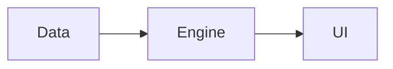

# Plan

## Architecture

## Tasks
Each task is about half a day or less, names its criterion and the test that proves it.

| # | Task | Criterion | Test that proves it | Owner | Parallel with | Status |
|---|---|---|---|---|---|---|
| 1 |  | C1 |  |  |  | todo |

>> YOU ARE HERE: Phase 5, task 1 not started

## Decision log
| Date | Decision | Why |
|---|---|---|
